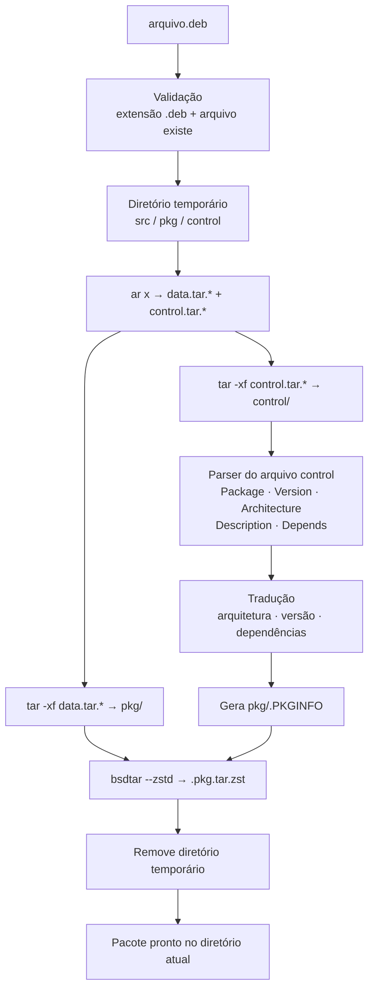

# 📦 deb2pacman
<div align="center">
 
**Converta pacotes Debian (`.deb`) em pacotes nativos do Arch Linux (`.pkg.tar.zst`) com um único comando.**
 


 
</div>

---
 
## 📑 Sumário
 
- [Visão geral](#-visão-geral)
- [Funcionalidades](#-funcionalidades)
- [Requisitos](#-requisitos)
- [Instalação](#-instalação)
- [Uso](#-uso)
- [Exemplo completo](#-exemplo-completo)
- [Como funciona](#️-como-funciona)
- [Regras de conversão](#-regras-de-conversão)
- [Estrutura do pacote gerado](#-estrutura-do-pacote-gerado)
- [Personalizando o mapa de dependências](#-personalizando-o-mapa-de-dependências)
- [Limitações conhecidas](#️-limitações-conhecidas)
- [Códigos de saída](#-códigos-de-saída)
---
 
## 🔎 Visão geral
 
O **deb2pacman** é um utilitário de linha de comando, escrito em um único script Lua, que pega um arquivo `.deb` (formato de pacote do Debian, Ubuntu e derivados) e produz um pacote `.pkg.tar.zst` que pode ser instalado diretamente com `pacman -U`.
 
Ele **não recompila nada**: os binários e arquivos do programa são reaproveitados como estão. O script apenas extrai o conteúdo do `.deb`, traduz os metadados (nome, versão, arquitetura, descrição e dependências) para o formato que o `pacman` entende e reempacota tudo.
 
> 💡 Ideal para programas distribuídos apenas como `.deb` (navegadores, editores, ferramentas proprietárias) quando você quer que o `pacman` os gerencie, em vez de instalá-los "por fora" do gerenciador de pacotes.
 
---
 
## 🌟 Funcionalidades
 
| Recurso | Descrição |
| --- | --- |
| 🗜️ **Extração automática** | Abre o contêiner `ar` do `.deb` e descompacta `data.tar.*` (arquivos do programa) e `control.tar.*` (metadados), em qualquer compressão que o `tar` suporte (`.gz`, `.xz`, `.zst`…). |
| 🧾 **Leitura do `control`** | Extrai `Package`, `Version`, `Architecture`, `Description` e `Depends` do arquivo de controle do Debian. |
| 🔁 **Tradução de arquitetura** | `amd64` → `x86_64`, `i386` → `i686`, `all` → `any`. |
| 🔢 **Adaptação de versão** | Troca `-` por `_` na versão (o Arch não aceita hífen no `pkgver`) e acrescenta `-1` como `pkgrel`. |
| 🧩 **Tradução de dependências** | Converte nomes de pacotes Debian para Arch por meio de um dicionário (`dep_map`), remove restrições de versão e elimina duplicatas. |
| 📝 **Geração de `.PKGINFO`** | Cria o arquivo de metadados nativo do `pacman` na raiz do pacote. |
| 📦 **Empacotamento com zstd** | Gera o `.pkg.tar.zst` com `bsdtar` + compressão Zstandard, o padrão atual do `pacman`. |
| 🔊 **Modo verbose** | `-v` / `--verbose` mostra cada etapa, cada arquivo extraído/empacotado e os metadados encontrados. |
| 🎨 **Interface colorida** | Mensagens com cores ANSI no estilo do `pacman` e tratamento de erros com código de saída. |
| 🧹 **Limpeza automática** | Todo o trabalho é feito em um diretório temporário, removido ao final. |
 
---
 
## 📦 Requisitos
 
| Pacote (Arch) | Fornece | Para que serve |
| --- | --- | --- |
| `lua` | `lua` | Interpretador que executa o script |
| `binutils` | `ar` | Abrir o contêiner do `.deb` |
| `tar` | `tar` | Extrair `data.tar.*` e `control.tar.*` |
| `libarchive` | `bsdtar` | Criar o pacote final com compressão zstd |
| `zstd` | `zstd` | Compressão do pacote final (e leitura de `.deb` com `data.tar.zst`) |
| `xz` | `xz` | Leitura de `.deb` com `data.tar.xz` *(normalmente já instalado)* |
 
Além disso, o script usa `/bin/sh` com suporte a *brace expansion* (`{a,b,c}`), o que é o caso do Arch Linux, onde `/bin/sh` é o Bash.
 
Instale tudo com:
 
```bash
sudo pacman -S --needed lua binutils tar libarchive zstd xz
```
 
---
 
## 🚀 Instalação
 
O script está no arquivo `main.lua`. Para usá-lo como um comando global:
 
```bash
# 1. Clone o repositório
git clone <url-do-repositorio> deb2pacman
cd deb2pacman
 
# 2. Instale o script como "deb2pacman" (já com permissão de execução)
sudo install -Dm755 main.lua /usr/local/bin/deb2pacman

# 3. tem a opção de instalar via curl 
curl -sSL [https://raw.githubusercontent.com/Raph-Rodrigues/deb2pacman/refs/heads/main/install.sh](https://raw.githubusercontent.com/Raph-Rodrigues/deb2pacman/refs/heads/main/install.sh) | sudo bash
```

Para desinstalar:
 
```bash
sudo rm /usr/local/bin/deb2pacman
```
 
> Se preferir não instalar, basta executar direto: `lua main.lua arquivo.deb`.
 
---
 
## 💻 Uso
 
```text
deb2pacman [opções] <arquivo.deb>
```
 
### Opções
 
| Opção | Descrição |
| --- | --- |
| `-v`, `--verbose` | Mostra saída detalhada: arquivos sendo extraídos/empacotados e metadados lidos. |
| `-h`, `--help` | Exibe o menu de ajuda e encerra. |
 
### Exemplos
 
```bash
# Conversão simples
deb2pacman google-chrome-stable_current_amd64.deb
 
# Conversão com saída detalhada
deb2pacman -v google-chrome-stable_current_amd64.deb
 
# Ajuda
deb2pacman -h
```
 
### Instalando o pacote convertido
 
O pacote é criado no **diretório atual**. Instale-o com:
 
```bash
sudo pacman -U nome-do-pacote-bin-<versão>-<arquitetura>.pkg.tar.zst
```
 
---
 
## 🧪 Exemplo completo
 
```console
$ deb2pacman google-chrome-stable_current_amd64.deb
:: Extraindo pacote google-chrome-stable_current_amd64.deb...
:: Lendo metadados (control)...
:: Gerando .PKGINFO para o Arch...
:: Compactando novo pacote pacman...
=> Concluído! Pacote criado: google-chrome-stable-bin-130.0.6723.91_1-1-x86_64.pkg.tar.zst
 
Instale com: sudo pacman -U google-chrome-stable-bin-130.0.6723.91_1-1-x86_64.pkg.tar.zst
```
 
Como o nome do arquivo de saída é montado:
 
```text
google-chrome-stable  -bin  -130.0.6723.91_1  -1      -x86_64  .pkg.tar.zst
└──── Package ───────┘ └─┬─┘ └──── Version ───┘ └pkgrel┘ └─ arch ┘
                         └ sufixo adicionado pelo script
```
 
---
 
## ⚙️ Como funciona
 

 
### Passo a passo
 
1. **Argumentos e validação:** lê as opções, confirma que um arquivo foi informado, que ele termina em `.deb` e que pode ser aberto.
2. **Ambiente temporário:** cria um diretório único (via `os.tmpname()`) com as subpastas `src/`, `pkg/` e `control/`.
3. **Extração:**
   - `ar x` abre o `.deb` em `src/`;
   - `tar -xf src/data.tar.*` extrai os arquivos do programa em `pkg/`;
   - `tar -xf src/control.tar.*` extrai os metadados em `control/`.
4. **Parser do `control`:** lê o arquivo linha a linha e coleta as informações relevantes. Se o arquivo não for encontrado, são usados valores padrão (veja [limitações](#️-limitações-conhecidas)).
5. **Tradução:** ajusta arquitetura, versão e dependências para o padrão do Arch.
6. **Geração do `.PKGINFO`:** escreve o arquivo de metadados dentro de `pkg/`.
7. **Empacotamento:** `bsdtar --zstd` compacta o conteúdo de `pkg/` (incluindo o `.PKGINFO`) no diretório de onde o comando foi executado.
8. **Limpeza:** o diretório temporário é apagado.
---
 
## 🔄 Regras de conversão
 
### Metadados
 
| Campo no Debian (`control`) | Campo no Arch (`.PKGINFO`) | Regra aplicada |
| --- | --- | --- |
| `Package: nome` | `pkgname` | Convertido para minúsculas e acrescido do sufixo `-bin` (convenção do AUR para binários pré-compilados). |
| `Version: 1.0-2` | `pkgver` | Hífens viram `_` e `-1` é acrescentado: `1.0_2-1`. |
| `Architecture` | `arch` | `amd64` → `x86_64`, `i386` → `i686`, `all` → `any`; outros valores são mantidos como estão. |
| `Description` | `pkgdesc` | Apenas a primeira linha (resumo) é usada. |
| `Depends` | `depend` (uma linha por dependência) | Veja abaixo. |
| — | `builddate` | Timestamp Unix do momento da conversão. |
 
**Valores padrão** (usados se o `control` não for lido): `pkgname = pacote-convertido`, `pkgver = 1.0-1`, `arch = x86_64`, `pkgdesc = Convertido de <arquivo.deb>`.
 
### Dependências
 
Cada item do campo `Depends:` passa por este processamento:
 
1. A lista é separada por vírgulas.
2. Restrições de versão entre parênteses são removidas: `libfoo (>= 2.1)` → `libfoo`.
3. Espaços são removidos.
4. O nome é traduzido pelo `dep_map`; se não houver entrada, **o nome original é mantido**.
5. Duplicatas são descartadas.
Mapeamentos incluídos por padrão:
 
| Debian | Arch Linux |
| --- | --- |
| `libc6` | `glibc` |
| `python3` | `python` |
| `libgtk-3-0` | `gtk3` |
| `libasound2` | `alsa-lib` |
| `libx11-6` | `libx11` |
| `libnss3` | `nss` |
| `zlib1g` | `zlib` |
 
---
 
## 🗂️ Estrutura do pacote gerado
 
O `.pkg.tar.zst` contém exatamente a árvore de arquivos do `data.tar.*` do `.deb` (por exemplo `usr/`, `opt/`, `etc/`), mais o `.PKGINFO` na raiz:
 
```text
.PKGINFO
opt/
usr/
...
```
 
Exemplo de `.PKGINFO` gerado:
 
```ini
pkgname = google-chrome-stable-bin
pkgver = 130.0.6723.91_1-1
pkgdesc = The web browser from Google
arch = x86_64
depend = glibc
depend = alsa-lib
depend = libx11
builddate = 1767225600
```
 
Para inspecionar o resultado antes de instalar:
 
```bash
pacman -Qip nome-do-pacote.pkg.tar.zst   # metadados e dependências
pacman -Qlp nome-do-pacote.pkg.tar.zst   # lista de arquivos
```
 
---
 
## 🧩 Personalizando o mapa de dependências
 
Se o pacote convertido pedir uma dependência que não existe no Arch, adicione a tradução no dicionário `dep_map` do script:
 
```lua
local dep_map = {
	["libc6"] = "glibc",
	["python3"] = "python",
	-- ...
	["libgbm1"] = "mesa",           -- exemplo de nova entrada
	["libxss1"] = "libxss",         -- exemplo de nova entrada
}
```
 
Dica: use `pacman -F <arquivo.so>` (após `sudo pacman -Fy`) para descobrir qual pacote do Arch fornece uma biblioteca.
 
---
 
## ⚠️ Limitações conhecidas
 
O deb2pacman faz uma conversão **direta e simples**; ele não substitui o trabalho de um `PKGBUILD` bem feito. Tenha em mente:
 
**Conteúdo do pacote**
- 🖥️ Arquivos `.desktop` podem apontar para caminhos ou binários que não existem ou têm nomes diferentes no Arch.
- 📜 Scripts do Debian (`preinst`, `postinst`, `prerm`, `postrm`) **não são convertidos** para `.INSTALL`.
- 🗃️ Arquivos de configuração (`conffiles`) não viram `backup=`, e o `.MTREE` não é gerado.
- 📁 Pacotes Debian que instalam diretamente em `/bin`, `/sbin` ou `/lib` podem entrar em conflito com o pacote `filesystem` do Arch (que usa links simbólicos para `/usr`).
**Dependências**
- 🔍 Dependências sem entrada no `dep_map` são copiadas com o nome Debian e podem não existir no Arch.
- ➗ Apenas o campo `Depends` é lido (`Pre-Depends`, `Recommends`, `Suggests` etc. são ignorados).
- 🔀 Alternativas (`pacote-a | pacote-b`) e qualificadores (`pacote:any`) não são tratados.
- 🔢 Restrições de versão são descartadas.
**Execução**
- 📂 Informe o `.deb` por **caminho relativo** ao diretório atual; caminhos absolutos não são suportados. Evite também espaços no nome do arquivo.
- 🧪 Falhas durante a extração não são detectadas: se o `control` não puder ser lido, o script segue com os valores padrão (pacote chamado `pacote-convertido-bin`).
- ♻️ Se vários arquivos forem passados, apenas o **último** é convertido.
- 🏗️ Arquiteturas fora de `amd64`, `i386` e `all` (ex.: `arm64`) são mantidas com o nome do Debian, que o Arch não reconhece (`aarch64`).
- 📛 O pacote **sempre** recebe o sufixo `-bin` e `pkgrel` fixo em `1`.
> ✅ Antes de instalar, revise o `.PKGINFO` e a lista de arquivos do pacote gerado, especialmente se o `.deb` veio de uma fonte que você não conhece.
 
---
 
## 🚦 Códigos de saída
 
| Código | Situação |
| --- | --- |
| `0` | Conversão concluída com sucesso, ou ajuda exibida (`-h`). |
| `1` | Erro: nenhum argumento, arquivo não informado, extensão diferente de `.deb` ou arquivo não encontrado. |
 
---
 
<div align="center">
Feito em Lua 🌙 para quem quer o melhor dos dois mundos: pacotes `.deb` e a organização do `pacman`.
 
</div>

